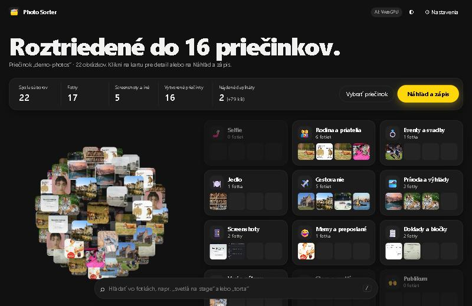

<p align="center">
  
</p>

<p align="center">
  <a href="https://davidbabjarcik.github.io/photo-sorter/"><b>▶ Otvoriť appku</b></a>
  &nbsp;·&nbsp;
  <a href="#-spustenie-lokálne">Spustiť lokálne</a>
  &nbsp;·&nbsp;
  <a href="SYNOLOGY.md">Nasadiť na Synology</a>
</p>

<p align="center">
  
  
  
  
</p>

---

**Photo Sorter** vezme priečinok plný neporiadku (fotky z mobilu, screenshoty, memy z WhatsAppu, bločky, kópie kópií) a roztriedi ho do prehľadných priečinkov podľa obsahu a dátumu. Všetko beží **lokálne v prehliadači**. Žiadny server, žiadny upload, žiadne konto.

<p align="center">
  
</p>

## ✨ Čo vie

| | |
| --- | --- |
| 🧠 **AI triedenie** | CLIP (transformers.js) rozpozná, čo je na fotke: selfie, rodina, jedlo, cestovanie, príroda, doklady… Beží na **WebGPU**, inak automaticky na WASM. |
| 🎛️ **Vlastné kategórie** | Kategórie aj ich textové prompty si upravíš v Nastaveniach. Pripravená je aj sada pre eventy: stage a svetlá, publikum, DJ pult, technika, backstage, plagáty. |
| 📱 **Screenshoty** | AI + heuristiky: PNG, chýbajúci EXIF fotoaparátu, rozlíšenie displeja, „Screenshot“ v názve. |
| 👯 **Duplikáty** | Presné kópie (SHA-256) aj takmer rovnaké fotky (perceptual hash + CLIP). Ponechá najkvalitnejšiu verziu a ukáže, koľko GB ušetríš. |
| 📅 **Podľa dátumu** | EXIF → dátum v názve súboru → dátum zmeny. Fotky zoskupí do eventov podľa časových medzier (`RRRR-MM-DD`). |
| 🍏 **HEIC z iPhonu** | Dekóduje sa cez libheif (WebAssembly), Chrome to sám nevie. |
| 🔍 **Vyhľadávanie** | Stlač <kbd>/</kbd> a napíš „torta“, „pes“ alebo „svetlá na stage“. Nájde najpodobnejšie fotky. |
| 🚀 **Desaťtisíce fotiek** | Web Workery, dávkové spracovanie, pauza a pokračovanie. Výsledky sa ukladajú do IndexedDB, takže ďalšie spustenie je rýchle. |
| 🛡️ **Bezpečný výstup** | Najprv náhľad bez zápisu, potom zápis do **nového** priečinka. Predvolene kopíruje, originály nemaže a nič neprepíše. Pribudne aj CSV report. |
| 🌗 **Svetlý aj tmavý režim** | Podľa systému alebo ručne. |

## 🧭 Ako to funguje

1. **Vybrať priečinok**: appka rekurzívne nájde `jpg`, `png`, `webp` a `heic`.
2. **Roztriediť**: fotky odlietajú z gule do kariet priečinkov. Prvýkrát sa stiahne AI model (raz, potom je v cache).
3. **Náhľad a zápis**: vyberieš štruktúru `Kategória/…`, `Dátum/…` alebo `Kategória/Dátum/…`, skontroluješ ju a zapíšeš do nového priečinka.

```
Roztriedené/
├── Cestovanie/
│   ├── 2024-08-10/
│   └── 2024-08-12/
├── Rodina a priatelia/
│   └── 2024-05-01/
├── Screenshoty/
├── _Duplikáty/
└── photo-sorter-report-2024-11-21.csv
```

## 🌐 Podporované prehliadače

| Chrome / Edge (Windows, macOS) | Firefox | Safari |
| :---: | :---: | :---: |
| ✅ | ❌ | ❌ |

Appka potrebuje File System Access API, ktoré majú len prehliadače na báze Chromium. Musí bežať cez **HTTPS** alebo `localhost`.

## 💻 Spustenie lokálne

Potrebuješ [Node.js](https://nodejs.org) 20+.

```bash
git clone https://github.com/davidbabjarcik/photo-sorter.git
cd photo-sorter
npm install
npm run dev
```

Otvor **http://localhost:5173** v Chrome alebo Edge.

| Príkaz | Čo robí |
| --- | --- |
| `npm run dev` | vývojový server |
| `npm run build` | produkčný build do `dist/` |
| `npm run preview` | spustí produkčný build na `localhost:4173` |
| `npm run synology:zip` | ZIP na nahratie na Synology ([návod](SYNOLOGY.md)) |
| `npm run synology:copy -- <cieľ>` | build a kopírovanie priamo na NAS |

## 🚀 Nasadenie

- **GitHub Pages**: po každom pushi do `main` sa appka automaticky nasadí na **https://davidbabjarcik.github.io/photo-sorter/**.
- **Synology NAS**: pozri [SYNOLOGY.md](SYNOLOGY.md).
- **Akýkoľvek statický hosting**: nahraj obsah `dist/`. Cesty sú relatívne, takže funguje aj v podpriečinku.

## 🔒 Súkromie

- Fotky, náhľady a AI embeddingy zostávajú **v tvojom prehliadači** (IndexedDB). Vymažeš ich v Nastaveniach.
- Z internetu sa sťahuje iba AI model z Hugging Face, a to raz.
- Žiadna analytika, žiadne cookies, žiadny backend.

## 🧩 Technológie

[Vite](https://vite.dev) · [transformers.js](https://github.com/huggingface/transformers.js) + [CLIP](https://huggingface.co/Xenova/clip-vit-base-patch32) · [ONNX Runtime Web](https://onnxruntime.ai) · [exifr](https://github.com/MikeKovarik/exifr) · [libheif-js](https://github.com/catdad-experiments/libheif-js) · [idb](https://github.com/jakearchibald/idb) · [vite-plugin-pwa](https://vite-pwa-org.netlify.app)

<details>
<summary><b>Štruktúra projektu</b></summary>

| Súbor | Účel |
| --- | --- |
| `src/main.js` | UI, stav, dialógy, vyhľadávanie |
| `src/engine.js` | orchestrácia: pool workerov, CLIP, cache, pauza |
| `src/workers/process.worker.js` | SHA-256, EXIF, rozmery, náhľad, dHash, HEIC |
| `src/workers/clip.worker.js` | CLIP embeddingy (WebGPU / WASM) |
| `src/classify.js` | zero-shot klasifikácia, heuristiky screenshotov, dátum |
| `src/dupes.js` | presné a takmer rovnaké duplikáty |
| `src/output.js` | eventy, plán (dry run), zápis, CSV report |
| `src/settings.js` | predvolené kategórie a prompty |
| `src/ball.js` | animovaná guľa z náhľadov |
| `scripts/synology.mjs` | ZIP a kopírovanie na Synology |

</details>

<details>
<summary><b>Testovací priečinok (vývoj)</b></summary>

Vo vývojovom režime otvor `http://localhost:5173/?demo` a klikni *Načítať testovací priečinok*. Súbory z `dev-fixtures/` (zoznam v `dev-fixtures/manifest.json`) sa skopírujú do súkromného úložiska prehliadača (OPFS) a výstup sa zapíše tiež tam. Priečinok `dev-fixtures/` nie je v gite, vlož doň vlastné testovacie fotky.

</details>
